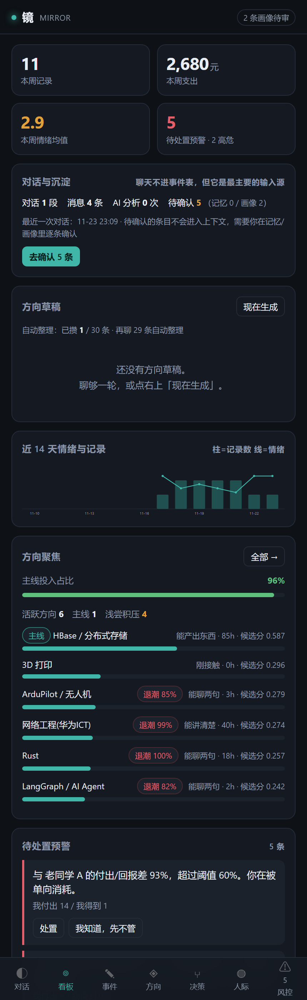
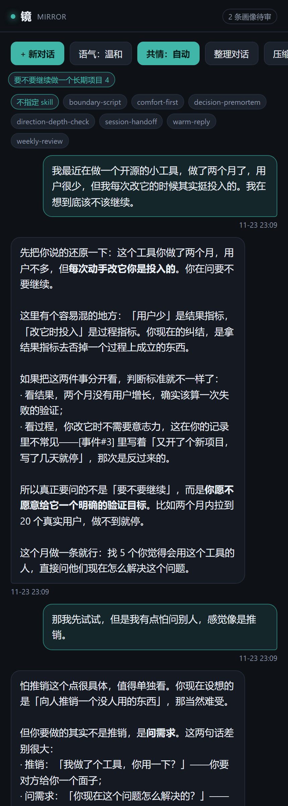
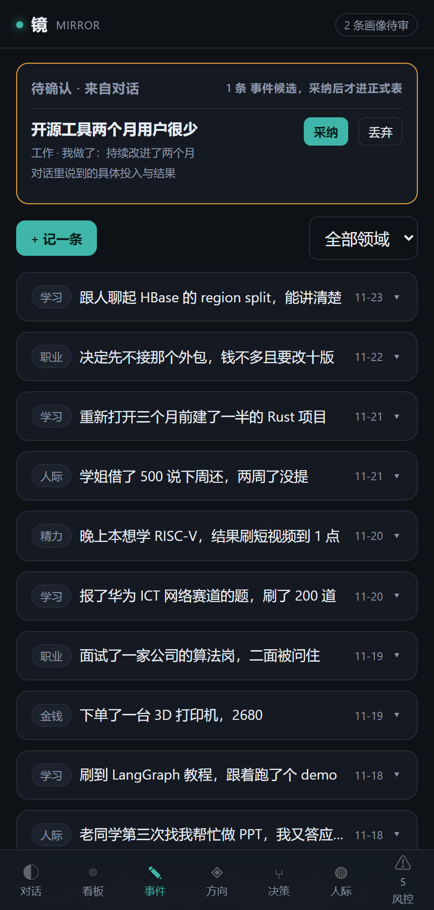

# 镜 · MirrorOS

> 一个跑在你自己电脑上的个人决策与复盘系统。
> **记录言行 → 反推性格 → 辅助重大决策 → 强制风控 → 找到该深挖的方向。**

[](LICENSE)
[](https://www.python.org)
[](#快速开始)
[](#数据在哪--每个人自己部署)

---

## 它是给谁用的

如果你有过这些时刻，这套东西是为它们写的：

- 「我很喜欢学习各种东西，但是**浅而不精**。我需要找到我最喜欢、而且能深入持续学的方向。」
- 明明算过一遍，事到临头还是凭手感做决定，事后复盘又想不起当时为什么那么选。
- 在一段关系里持续付出，说不出到底亏在哪，只是觉得累。
- 攒了很多笔记、待办、日记，但它们**从来不回话**——不告诉你任何关于你自己的结论。

**普通笔记记的是「发生了什么」。这套东西要回答的是「所以我是个怎样的人、下一步该押哪」。**

## 它和普通工具的区别

| | 笔记 / 待办 / 日记 | 镜 MirrorOS |
|---|---|---|
| 输出 | 一堆条目 | 带编号的结论：「你在需要设边界的场合默认先应付过去 [事件#12]」 |
| 证据 | 谁写的都算 | 每条结论必须挂真实事件编号，**AI 编造的编号会被自动标红丢弃** |
| 决策 | 记下选项 | MCDA 加权 + 悲观 + 后悔值三套算法 + ±20% 敏感性分析，逼你看清哪个结论是脆的 |
| 风控 | 靠自觉 | 9 条硬规则自动扫描：单向付出超阈值、支出冷静期、方向退潮、决策悬置…… |
| AI | 随便聊 | AI 只负责**提议**，写库前必须你确认；它说了不算 |
| 数据 | 在服务器上 | 只在你自己机器的 `data/mirror.db`，没有账号、没有云端 |

## 界面

| 看板：指标、方向退潮、待处置预警 | 对话：带编号的结论 |
|---|---|
|  |  |

整理对话之后，事件 / 方向 / 决策 / 人际 各自的页面顶部会出现「待确认」——
**采纳才进正式表**，不采纳就是一行字留在暂存区：



## 三个不太常见的取舍

**① 它不哄你，但也不审你。**
原来这套东西会追问「你说的事属实吗」。后来改掉了：它没有上帝视角，你也没有。
现在分四层标注——你说的、库里记的、它推断的、纯假设——**你说的默认采信**，
只在你自己两处叙述矛盾时才指出来，而且必须指到具体两句。

**② 温和与锋利不冲突。**
默认语气是「对事不对人」：判断落在说法上，不落在你这个人身上。
但它不会为了好听把结论说软——该说「这在数据上站不住」照说。

**③ AI 的产出一律是草稿。**
对话里提到的事，它能整理成事件/人物/方向/决策候选，也能给出方向草稿。
但全部落在暂存区，**你逐条采纳才算数**。理由很简单：模型提取的是它的阅读理解，
不是事实。让猜测变成结论的地基，这套系统就废了。

## 快速开始

```bash
git clone https://github.com/as5827/mirror-os.git
cd mirror-os
python -m app.server
```

第一次启动会：

1. 自动生成 `.env`，里面有**这台机器独有**的随机 PIN 和会话密钥，PIN 会打印在控制台
2. 自动建库 `data/mirror.db`，灌入 37 条知识库条目
3. 自动打开浏览器

然后去 `.env` 填上你自己的 `DEEPSEEK_API_KEY`，重启即可。
没有 Key 也能用，只是 AI 分析和对话不可用。

要求：Python **3.9+**，Windows / macOS / Linux 均可。**不需要 pip install，不需要 Docker。**

### 想先看看长什么样

```bash
python seed_demo.py      # 灌一套虚构演示数据
python -m app.server
# 用完后：python seed_demo.py wipe
```

### 想自己验证部署是否成功

```bash
python deploycheck.py    # 克隆到临时目录、不给配置直接启动、逐项验收 23 项
python payloadcheck.py   # 检查送给模型的上下文有没有重复（14 项）
```

## 已知的边界

不写清楚就是骗人：

- **AI 会说错话**，包括引用看似合理的编号。系统用编号校验拦掉一部分，但它不是权威。
- **知识库是通俗摘要**，可能有表述偏差。每条都带原始出处，引用前请核对。
- **联网文献只代表「机制层面存在这种可能」**，推不出「你就是这种机制」。
- **方向判断的质量取决于你记了多少**。材料不足时它会说不足，而不是编一个听起来合理的答案。
- **它不是心理治疗**。检测到自伤/轻生表达会给求助建议，但紧急情况请拨 120 / 110。

---

## 零、数据在哪 · 每个人自己部署

**这不是一个网站服务，没有账号、没有云端、没有作者服务器。**

| 你可能关心 | 实际情况 |
|---|---|
| 我的记录会传到作者那里吗 | 不会。数据只在你自己机器的 `data/mirror.db` |
| 别人能看到我的数据吗 | 不能。每人部署独立，数据库不随代码分发 |
| 用 AI 时会传什么 | 只在你发消息/点分析时，把**当前这段上下文**发给 DeepSeek；不传数据库 |
| 联网检索会传什么 | 只有检索词（英文理论名或关键词），不传你的记录 |

### 每个人自己部署、自己记录

1. 克隆 / 下载本项目到自己机器
2. 启动一次 → **自动生成本机独有的 `.env`**（随机 PIN + 随机会话签名密钥），PIN 打印在控制台
3. 填上你自己的 DeepSeek API Key
4. 从这个空数据库开始记录**你自己的**数据

> 为什么仓库里不放 `.env`：如果所有人共用一个 `MIRROR_SECRET`，
> 一个人就能伪造另一个人的登录 Cookie。所以每个部署必须自己生成。

### 安全边界（说实话）

- 网页登录只有 **PIN 一道防线**，没有多用户体系。几个人共用一台电脑 = 同一个账号。
- 手机访问需要把服务绑到 `0.0.0.0` 并放行端口。**同一 WiFi 下知道 PIN 的人都能访问**，
  不要在公共 / 公司网络这样开。
- 数据库文件**没有加密**。整机被拿走，数据就能被读。真敏感请配合 BitLocker 之类的磁盘加密。
- `.gitignore` 已排除 `.env`、`data/`、截图、以及你的 `persona.txt`。提交前仍建议跑一次
  `git status` 确认没有私人文件混进去。

---

## 一、启动

**最省事的方式：双击桌面上的 `镜 MirrorOS` 图标。**
它会自己判断：服务没跑就后台启动，然后直接打开浏览器。已经在跑就只开浏览器，不会起第二个。

也可以双击 `<安装目录>\启动.bat`，效果相同。要停止就双击 **`停止.bat`**（或关掉那个最小化的窗口）。

登录 PIN 在 `.env` 里（当前是 `（见 .env 里的 MIRROR_PIN）`）。

- 服务在后台跑，日志在 `data\server.log`
- 手机访问地址：`http://<你的电脑局域网IP>:8765`（电脑 WiFi 变了地址也会变，用 `ipconfig` 查）

> 为什么用后台启动而不是黑窗口：你要长时间挂着对话，一个必须留着的控制台窗口很容易被误关。

### 手机接入（三步）

1. 第一次先在电脑上双击 **`开启手机访问.bat`**，UAC 弹窗点「是」。
   它只对「专用/域」网络放行 8765 端口，公共 WiFi 不放行。
2. 手机连**和电脑同一个 WiFi**（不能是手机流量）。
3. 手机浏览器打开 `http://电脑IP:8765`，输入同一个 PIN。
   - Android Chrome：菜单 →「添加到主屏幕」
   - iOS Safari：分享 →「添加到主屏幕」
   之后就是一个独立图标，全屏无地址栏。

> 电脑关机或黑窗口关掉，手机就访问不了。这是本地优先的代价，也是数据不外流的保证。

### 可选：开机自启

把 `启动.bat` 的快捷方式丢进 `shell:startup`（Win+R 输入 `shell:startup` 回车打开的文件夹）即可。

---

## 二、三条铁律（这是这套系统和「记事本」的区别）

系统**在数据库层面**拒绝敷衍，不是靠自觉：

| 铁律 | 触发点 | 后果 |
|---|---|---|
| 否决必须留理由 | 决策里每个没被选中的分支 | 少于 8 字不让保存 |
| 二阶效应必须推三层 | 选中的方案 | 少一层不让标「已决定」 |
| 画像必须挂真实证据 | AI 生成的性格结论 | 引用的事件编号在库里查不到 → 整条丢弃 |

另外这些也要写理由才放过：封存方向、驳回画像、降级/切断某人、关闭预警、放弃支出、决策复盘。

**为什么这么设计**：你要的是以后能回答「当初为什么断了这个人 / 为什么放弃这个方向」。没有理由的放弃，等于把自己的历史删掉。

---

## 三、七个模块怎么用

### ⓪ 对话（默认首页）
这是长期用的主界面。它不是一个「聊天框」，而是每次都带着分层记忆进场：

| 注入层 | 内容 | 上限 |
|---|---|---|
| 长期记忆 | 你确认过的事实（`active`） | 40 条 |
| 已采纳画像 | 可被推翻的结论（`accepted`），附你定过的反制 | 12 条 |
| 滚动摘要 | 把老对话压成交接摘要，原文仍在库里 | 3 段 |
| 最近原话 | 最近的对话轮次 | 16 条 |
| 相关旧事 | 用你这句话去 FTS 检索历史事件 | 8 条 |
| 知识库 | 37 条理论的紧凑索引 + 最相关的 3 条完整条目 | 索引 + 3 |
| Skill | 选中那个 skill 的正文（没选就只给名称+用途） | 1 个 |

**准确性机制**：模型必须用 `[事件#12]` `[决策#3]` `[记忆#5]` `[画像#2]` 标注引用。回复落库前，服务端**逐条校验编号是否真实存在**——编造的会被标红并警告「它在编证据」。气泡下方的彩色 chip 就是校验通过的引用。

**长对话不会撑爆上下文**：单次上下文硬上限 26000 字，超了从最老的轮次开始丢；消息超过 60 条自动压缩成摘要（也可手动点「压缩记忆」）。实测一段 1909 字的对话压缩后降到 1390 字，而四段式结构完整保留。

**失败不丢输入**：你的消息先落库再调模型；AI 报错时输入框会恢复原内容，可直接重试。

「搜旧话」可在所有历史对话里按关键词翻旧账（3 字以上走全文索引，2 字自动退到模糊匹配）。

### 共情体例：先安慰，还是先分析

对话页有 **「共情」** 按钮，四态循环：**自动 → 先共情 → 直接分析 → 自动**。

**为什么要做成开关，而不是固定一种**：你原本要求「不要安慰」，所以早期版本的提示词是硬性禁止安慰。
那在情绪最差的时候会二次伤害——分析越准，越像「你说得对，所以我更没救」。
但反过来永久「先安慰」也不行：纯任务问题（「该不该继续深挖 HBase」）前面垫两句情绪话，是浪费你时间。

所以由**情绪信号**决定，不是由模型猜：

| 档位 | 触发 | 做法 |
|---|---|---|
| 0 无信号 | 纯任务提问 | 直接分析，不加任何情绪铺垫，结尾也不追加关怀问句 |
| 1 轻度 | 「有点烦」「不太顺」 | 一句确认，立刻进分析 |
| 2 明显 | 「很难受」「被白嫖」「搞砸了」 | 共情 2–4 句 → 一句转场 → 分析 |
| 3 强痛苦 | 「撑不住」「什么都做不好」「撑了很」 | 共情 → 交出控制权（要不要现在谈）→ **强制给回谈锚点**，不许悬置 |
| crisis | 自伤/轻生信号 | 不进分析：共情 + 说清边界（我不是心理治疗）+ 具体求助动作 |

判定是可解释的词表打分（[comfort.py](app/comfort.py)），不是黑箱。所以你能看到这轮为什么被这样处理。

**三条硬约束**（写在提示词里，实测生效）：

1. **共情必须指向你的原话**，准确命名情绪。实测把「被白嫖的难受」命名为
   「明知结构没变还再进一次场的窝火，气里有对自己的那一份」——而不是笼统的「被伤害」。
2. **共情不得改写事实，也不得因为安慰就把结论说软**。同一轮回复里照样会说
   「你在需要持续设边界的场合，默认动作是『先应付过去』，而不是『改结构』」。
3. **不许把流程小标题写进正文**（「第一步」「共情段」这类词），直接说人话。
   ——这条是踩出来的：早期版本模型会把我提示词里的步骤名照抄成回复标题，机械感很重。

**还有一条 skill**：`comfort-first`（`skills/comfort-first/SKILL.md`），写的是完整规程，
你可以直接改它对共情的具体要求——比如觉得 2–4 句太长，改成 1–2 句。

**边界**：分析类模块（性格画像、决策压力测试、人际复核、方向诊断）**保持冷**，不做共情。
它们是分析仪器，不是对话伙伴，在报告里垫安慰会污染判断。

### 话术层：这句话到底怎么说出口

共情管「体例」，话术管「具体那句话」。你问「我该怎么回他」「怎么拒绝」「怎么安慰」时，
系统自动识别情境，产出**能直接复制照说的原话**——不是原则。

**为什么不能只靠模型自由发挥**：问它「怎么说比较好」，它默认会给一堆原则
（「要真诚」「要换位思考」）。那是废话，你要的是一句话。

**得体 = 三样东西对齐**：关系距离（能不能开玩笑、有没有权力差）、事情重量、
你要的结果（保关系还是保结果）。这三样不写清，产出的必然是套话。

所以按情境给**温暖度 / 直接度**配比（各 1–5），判定是可解释的关键词规则（[phrasing.py](app/phrasing.py)）：

| 情境 | 温暖 | 直接 | 判据 |
|---|---|---|---|
| 拒绝朋友 | 3 | 4 | 第一句直接，后半句给台阶 |
| 拒绝越界索取 | 2 | 5 | 温暖给够用就好，多了是被拿捏 |
| 向导师/上级提要求 | 3 | 3 | 留白，不把话说死 |
| 道歉 | 4 | 4 | 认错要具体，不用「如果我让你不舒服」 |
| 向同事指问题 | 3 | 4 | 对事不对人，只打一个点 |
| 安慰受伤的人 | 5 | 1 | 不给建议，除非他要 |

**输出结构（固定四段）**：

1. 一句定位：场景 = 关系 + 你要的结果
2. **A 版原话**（偏暖，保关系）
3. **B 版原话**（偏直，保结果）
4. 风险预判 + 接续句（对方追问时第二句说什么）

**实测样例**（问「朋友刚失恋，我该怎么安慰他？」）：

> A 版：「我不问你为什么分的，也不劝你想开。今晚我过来，带两瓶酒，你不想说话我们就坐着。」
> B 版：「这事我不劝你，劝也没用。你现在最难受的是哪一块——是没人在了，还是觉得自己被否了？你说，我听着。」
> 风险：B 版第一句「劝也没用」语气不对会被听成「你别烦我」。要防的是他逞强说「我没事，你忙你的」——那是把你推开的客气，不是真没事。
> 接续：他要是说「没事」，你就说「行，那我明天中午找你吃饭，你不来我就当你还在生气」。给一个具体时间点，别问「要不要」。

### 温暖来自具体，不来自形容词

这是最有操作性的判据，写进了提示词：

- ❌「你真的辛苦了，要好好照顾自己」——去掉形容词后什么都不剩，是套话
- ✅「你连续三周加班到十一点，还替我垫了报告——这不是辛苦，是被掏空」

**判据**：去掉形容词后还剩具体事实 → 有效；什么都不剩 → 删掉重写。

### 踩过的两个坑

1. **内部判断漏到正文**：早期版本会在回复里报「温暖度 5/5、直接度 1/5」，还汇报
   「两版的主语都是『我』」——那是给自己看的检查表，不是给对方说的话。已明令禁止。
2. **模糊承诺**：「我看看」「我尽量」「有机会」「下次」这类词会让拒绝变成半答应，
   等于没说。两版都禁用。

**相关 skill**：`warm-reply`（`skills/warm-reply/SKILL.md`），规程可改。
和 `boundary-script` 的分工：后者专管拒绝/划边界，前者覆盖道歉、请求、安慰、负反馈、修复等更宽的范围。

### ① 事件（事实层）
记录标准只有一个：**具体发生了什么，你说了什么、做了什么、对方怎么反应。**
不写「我觉得他很过分」，写「他说『再改改』，我回『行吧』，然后改了两版」。

带 `重来我会怎么做` 字段——这是唯一能把事件变成经验的地方。

> 建议每天 1 条，30 秒。宁可粗糙也不要空白。

### ② 方向（解决「什么都学、什么都不深」）
每个学习主题都算深度（0 刚接触 → 5 能靠它吃饭）、投入小时、作品数、兴趣分，然后算出：

- **候选分** = 深度 40% + 跨月持续性 25% + 兴趣 20% + 投入未退潮 15%
- **投入退潮** = 近 30 天投入速度 vs 历史月均速度。退潮 80% 意味着「你这两个月基本没碰它，只是嘴上还在说想学」
- **浅尝积压** = 深度 ≤1 且 30 天没动、又不是主线的主题数量。这个数字就是你「浅而不精」的量化证据

点 **「AI 诊断：我该深挖哪个」**，它会指出：如果你在这个主题上停手，真实原因是什么；什么信号出现才说明你是真喜欢（而不是喜欢刚学的那一刻）；以及 90 天具体动作。

### ③ 决策（MCDA + 压力测试）
填准则权重、方案打分，系统算三种结论：

- **加权分**（常规）
- **最差项 / maximin**（悲观视角：最坏那项能接受吗）
- **最小后悔 / minimax regret**（不选它，将来最后悔吗）

然后做**敏感性分析**：单个准则权重上下浮动 20%，冠军会不会换人。
- 会换 → 判「**脆弱**」，说明你的权重是随手拍的
- 三种规则一致 → 判「**稳健**」，可以执行

点「AI 压力测试」，四种立场轮番攻击你的假设（风险厌恶者 / 增长乐观者 / 你的对手 / 三年后的你），再做一次事前验尸。

### ④ 人际（防被当血包）
只记两面账：谁给、谁得、权重多少。系统算「失衡度」= (我付出 − 我得到) ÷ 我付出。

- 超 60% → 标「单向消耗」
- 超 14 天无往来 → 标「悬置」

点「AI 复核边界」，会给一句**你可以照着说的原话**——不带指责、不留解释空间、也不讨好。

### ⑤ 风控（阈值与预警）
九条冷血规则，阈值全部可改：

| 规则 | 默认 | 触发后 |
|---|---|---|
| 并行主线上限 | 3 条 | 再立第 4 条主线直接被拒 |
| 浅尝未深 | 30 天 | 列出所有停在表面的方向 |
| 深度停滞 | 45 天 | 已进场但没升级 |
| 主线投入占比下限 | 50% | 精力漂移报警 |
| 悬置判定 | 14 天 | 人际悬置 |
| 单向索取 | 60% | 付出/回报失衡 |
| 冷静期门槛 / 时长 | 500 元 / 3 天 | 冷静期内批准会被系统拒绝 |
| 决策复盘宽限 | 7 天 | 复盘逾期 |
| 悬而未决 | 14 天 | 生成了决策却迟迟不定 |

预警必须处置：写清「你打算做什么」或「为什么现在不管」，两者都留档。

### ⑥ 看板
本周记录数、本周支出、本周情绪均值、待处置预警、14 天情绪曲线、主线投入占比、方向候选分排行。

---

## 四、Skills（兼容 Agent Skills 规范）

格式照搬公开标准 [`anthropics/skills`](https://github.com/anthropics/skills)：一个 skill = 一个文件夹 + `SKILL.md`，frontmatter 只有两个必填字段。

```
<安装目录>\skills\
├─ decision-premortem\SKILL.md      决策事前验尸
├─ boundary-script\SKILL.md         边界与拒绝话术
├─ direction-depth-check\SKILL.md   方向深挖体检
├─ weekly-review\SKILL.md           每周复盘
├─ session-handoff\SKILL.md         会话交接
├─ comfort-first\SKILL.md           先共情再分析
└─ warm-reply\SKILL.md              得体话术：给可照说的原话
```

```markdown
---
name: my-skill-name
description: 说清它做什么、什么时候用（这句话决定它会不会被选中）
---

# 标题
正文 = 你要求 AI 遵循的作业规程
```

**关键设计——渐进披露**：系统提示里只放每个 skill 的 `name + description`（约 30 字），**不放正文**。只有你在对话页选中某个 skill 时，才把它的正文注入。所以挂 50 个 skill 也只多花约 1500 字，长对话不会被技能库撑爆。

**自己加 skill**：在 `skills/` 下新建文件夹 + `SKILL.md` 即可，刷新页面就出现在技能条里。不需要改代码、不需要重启服务。也意味着你可以直接拿社区现成的 SKILL.md 丢进来用。

**为什么没做成「自动选 skill」**：自动匹配中文意图很容易选错，而选错一个流程性 skill 的代价比不选更大。所以是显式选择——你选，它执行。

---

## 五、知识库：心理学 / 社会学 / 行为经济学

系统里有**两个库**，别混：

| | 存什么 | 谁产生 | 可信度 |
|---|---|---|---|
| **个人库**（`events` / `traits` / `decisions` …） | 你身上发生的事实 | 你记录 + AI 分析 | 高，但要你确认 |
| **知识库**（`theory`） | 公共理论条目 | 我预置的 37 条，你可改可加 | 中等，标了出处供你核对 |

### 为什么单独建库，而不是让 AI「凭记忆用心理学」

因为**不可审计**。模型说「心理学研究表明」时，你无法核对它引的是哪条、是不是编的、有没有把有争议的理论当定论。这违反这套系统的第一原则。

所以知识库条目强制带四个字段，缺一不让存：

- `summary` 核心机制（一句话）
- `applies` 适用条件（什么时候**该**用它）
- `misuse` **误用风险（必填）**——这类概念最大的危害是被拿去给人贴标签
- `signal` 在你的数据里对应什么信号

### 怎么起作用

1. **紧凑索引**：每次对话把 37 条的名称 + 适用条件放进上下文（约 1.4k 字），模型知道库里有啥
2. **按需注入详情**：字符二元组重叠 + 标签加权，挑最相关的 3 条完整注入（含误用风险）
3. **强制引用**：用它必须写 `[理论#33]`，编号**逐条校验**，编的标红
4. **库里没有的必须承认**：模型若用库外概念，必须明说「来自通用知识，不在你的库里」并降低可信度

第 4 条是实测效果。问它「用自我损耗理论解释我晚上没力气」，它回答：

> **不在你的库里。** ……但这个理论本身有问题，必须说清：它的大规模重复实验基本没能复现核心效应……拿它解释你的晚上状态，是**用一个本身站不稳的框架去套一个你还没测量的现象**——这在你「只认证据」的标准下不合格。

### 现在的 37 条

心理学 19（认知失调、基本归因错误、习得性无助、自我决定论、蔡格尼克、依恋类型、自我分化、心理抗拒…）·
社会学 12（社会交换理论、互惠规范、弱关系、拟剧论、情感劳动、参照群体、结构性不平等、搭便车…）·
行为经济学 5（沉没成本、损失厌恶、双曲贴现、心理账户、锚定）· 方法论 1

**诚实声明**：这些是**我整理的摘要，不是原文引用**。`出处` 列给了作者与年份供你核对，可能存在表述偏差。其中「成长型心态」明确标了**有争议**（后续大规模重复实验效果偏小），不要当铁律用。

**自己加条目**：风控页 → 知识库，或调 `POST /api/theory`。`misuse` 留空会被拒绝——这条限制是故意的。

### 联网检索：给理论找真实文献

知识库条目的「出处」是我写的，你要核对就得联网。所以每条后面有 **「查文献支撑」** 按钮：点一下去学术 API 查真实论文，显示**被引次数、期刊、DOI**。

对话页还有一个 **「联网」** 按钮，点一下循环切换：**关 → 中英 → 中文 → 英文 → 关**（默认关）。开着时每次提问会：

1. 从匹配到的理论条目生成检索词——**中文取 tags 里在问题中真的出现过的那个词**（如「拖延」），**英文取理论的 en 名**
2. 查 OpenAlex / Crossref，取前 4 条
3. 注入上下文，AI 可用 `[文献#12]` 引用，编号同样逐条校验
4. 结果落 `reference` 表缓存 72 小时——断网后仍能查到、仍能引用

### 中文检索（实测可行，但踩过坑）

| 方式 | 结果 |
|---|---|
| `search=拖延` | ❌ 全是英文噪声（返回 DeepSeek-VL2） |
| `filter=language:zh,title_and_abstract.search=拖延` | ✅ 精准命中中文学术文献 |
| `title_and_abstract.search=拖延 论文`（多词） | ❌ 噪声剧增（搜出口吃研究） |
| 用理论全名当检索词（「拖延的情绪调节视角」） | ❌ 命中率为 0 |

所以：**只查一个短关键词**，且必须过「标题/摘要真的含这个词」的硬过滤；不命中就返回空——宁可没有文献，也不拿噪声冒充理论支撑。OpenAlex 中文库约 **564 万条**。

### 中文提问也能检索到英文文献

这是单独做的一层：**中英关键词对照表**（[lexicon.py](app/lexicon.py)，约 120 组）。

原来英文检索词只来自「理论条目的英文名」，导致两个问题：

1. 问题没命中任何理论时（实测 5 个问题里 3 个如此），中英文检索词**同时为空**，联网直接失效；
2. 即使命中了，也会**搜错方向**——问「睡眠差和拖延」，英文词却是 `Loss Aversion`（因为最匹配的理论是损失厌恶），检出的文献全不对题，AI 自己都拒绝引用。

现在改成**你的原话优先**：

> 「我睡眠很差…这跟我的拖延有关吗？」
> → 中文「拖延」+ 英文 `procrastination sleep`
> → 检出 **Bedtime Procrastination: A Behavioral Perspective on Sleep**（被引 58）、
> General procrastination and bedtime procrastination as self-regulation failures（被引 18）、
> Sleep Effort and Insomnia Severity: The Role of Bedtime Procrastination（被引 10）

用中文问，检出了英文研究里「睡前拖延（bedtime procrastination）」这个**独立研究方向**。

三条实现约束（都是实测出来的）：

- **理论英文名只作兜底**，不再优先——否则中文问题会被理论带偏检索方向
- **最多 2 个概念、总词数 ≤ 5**：OpenAlex 多词是 AND（`sleep` 2.57M → `sleep deprivation` 235K），词堆多了直接归零
- **双语合并按名额分配**（`both` 各占一半，一侧不足用另一侧补满）——否则中文一次返回 4 条会把名额占满，英文永远进不来

**AI 会自己评期刊层级**，实拍回复：

> [文献#28] 综述……来自《现代教育论坛》——**期刊层级低，被引 10 次只说明关注度**，只能支持「拖延成因多样、含情绪因素」这一层。
> [文献#31]……**样本是医药类本科生，不是你**；它支持的是机制层面「远期视角弱→拖延多」的可能，推不出你就是这种机制。

### 实测拿到的英文样本（真实数据，不是举例）
- 拖延 → Steel 2007《The nature of procrastination》*Psychological Bulletin*，被引 5297
- 双曲贴现 → Laibson 1997《Golden Eggs and Hyperbolic Discounting》*QJE*，被引 7336
- 认知失调 → Festinger 1957《A Theory of Cognitive Dissonance》，被引 31344

**三层防夸大**：
- 提示词强制：被引次数只说明关注度，不证明结论成立；文献支持的是「机制层面存在这种可能」，**推不出「你就是这种机制」**
- 被引普遍很低（<10）时，上下文会附加警告「可能只是 Crossref 兜底结果，作为理论支撑很弱，引用时必须向用户说明」
- arXiv 来的预印本标明「未经同行评审」

**已知限制（诚实说明）**：
- **OpenAlex 会 429 限流**。实测反复查询后会触发 IP 级限制，此时自动退到 Crossref——但 Crossref 相关性与影响力都明显更弱，会出现被引 0–1 的冷门章节。缓解：`.env` 填 `MIRROR_MAILTO=你的邮箱`（进礼貌池配额更宽），或等几分钟。
- **通用网页搜索不可用**：本机 Wikipedia（中/英）与 DuckDuckGo 都连不通，Semantic Scholar 返回 429。所以只有学术源，没有「随便搜网页」。
- **中文源被限流时**会自动退到 Crossref 中文兜底，但它相关性差（查「拖延」会返回「疝气拖延不治」这类），只在标题含查询词时才采纳，且被引多为 0，界面会标「弱支撑」。
- 联网时发出去的**只有检索词**（英文理论名），不发你的记录内容；开关是显式的，打开时二次确认。

---

## 六、记忆：它记得事实，也记得结论

系统有两层记忆，可信度不同，混着用会出事：

| 层 | 存哪 | AI 怎么对待 | 你能否推翻 |
|---|---|---|---|
| **长期记忆** | `memory` 表，风控页手动写 | 当作**前提**，不质疑、不重新推导 | 你亲手写，也能亲手作废（要写理由） |
| **画像（结论）** | `traits` 表，AI 生成 | **只有「已采纳」的**会注入；「驳回的」会注明「用户认为不成立」；**草稿绝不注入** | 驳回即失效，驳回理由会留档 |

每次 AI 分析都会带上这些东西，所以它不会每次都从零开始推你：

- **性格分析**：如果新证据加强了某条旧结论，它不再换个说法重讲一遍，而是在「对既有结论的更新」里写「加强 / 修正 / 推翻」+ 依据的事件编号。
- **决策压力测试**：会读你**过去所有决策的复盘教训**（尤其判错的那些），并输出 `repeating_mistakes`——直接指出你这次正在重犯哪一条。
- **人际复核 / 方向诊断**：会参考你已经确认的行为模式，追问「这次是不是又在印证它」。

**防污染机制**（重要）：
一条还没被你确认的 AI 猜测如果被反复注入，会自我强化成「事实」。所以回灌只碰 `accepted`。另外 AI 自己会标 `duplicate_of_id`：如果一条新画像是旧结论的换措辞，画像卡片上会出现「疑似 #N 换措辞」的黄色提示，建议直接驳回。

**透明度**：每次分析后弹窗会告诉你「喂给 AI 的记忆：已采纳 X 条 / 已驳回 Y 条 / 长期记忆 Z 条」。`reports` 表里也存了 `injected` 与 `recalled_event_ids`，可事后核对当时到底给了它什么。

### 检索（recall）：不再「只看最近 80 条」

原来只喂最近 80 条事件，更早的记忆会被窗口挤掉。现在加了 **SQLite FTS5 + trigram** 全文索引（`events_fts`，外部内容表模式，不复制数据，三个触发器自动同步增/改/删）：

- **方向诊断**：按主题名召回相关旧事件——之前它只看得到数字，看不到你学这些东西时**实际发生了什么**
- **决策压力测试**：按标题/背景/方案名召回历史上类似情境
- **人际复核**：按名字/关系/备注召回「提到他、但没归档到他名下」的事件

**一个实测发现的限制**：trigram 分词要求查询 ≥3 个字符，而中文「面试」「边界」这类双字词极常用。所以做了混合检索——**≥3 字走 FTS 按相关度（bm25）排序，2 字自动退到 LIKE 兜底**。只用 FTS 会静默漏掉这些词。

### 巩固（consolidation）：把旧事件压成记忆

风控页「**从旧事件提炼记忆**」会取 30 天前、尚未提炼过的事件，按领域分组，让 AI 压缩成「关于你的少数几条规律」，每条必须挂 ≥2 个真实事件编号。

- 产物是 **`draft` 状态，不进入 AI 上下文**，需你逐条「确认」或「作废」
- 提炼过的事件标记 `consolidated=1`，**不会重复烧 token**
- 证据不足时返回空数组而不是硬编——宁可没有记忆，也不要假记忆

> **为什么没直接接 mem0 / Letta / Zep / cognee**：这些框架都依赖 embedding，而 **DeepSeek 没有 `/embeddings` 端点**（实测返回 404）。要接就得再引 torch/sentence-transformers（2GB+）或第二个 API 供应商，两者都会破坏「本地优先、零第三方依赖、数据不出本机」。所以把它们的两个核心能力（recall + consolidation）用 SQLite 原生能力 + DeepSeek 自己实现了。

---

## 七、AI 与数据流向

- 调的是 DeepSeek `deepseek-chat`，Key 存在 `.env`，**不回显、不写日志**
- 走**直连**，不走系统代理（这台机器的 WinINET 代理 127.0.0.1:7897 对 api.deepseek.com 是坏的）
  - 如果哪天需要走代理：在 `.env` 加 `MIRROR_PROXY=http://127.0.0.1:7897`
- 每次分析发出去的是**事件摘要**（标题、我说、我做、反应、重来）+ 已采纳结论 + 长期记忆
- 所有 AI 原始返回都存进 `reports` 表，可复算、可追责
- 想彻底不用 AI：不点分析按钮即可，其余功能全部离线可用

---

## 八、备份与自检

**启动时自动做三件事**：`PRAGMA integrity_check` 自检 → 通过才启动 → 存一份启动备份。自检不通过会**先备份再拒绝写入**，避免在坏库上继续写。

- **自动备份**：`data\backups\`，每次启动一份 + 你手动点「立即备份」。用 SQLite 原生 backup API（WAL 模式下直接拷文件是不安全的），**自动保留最近 10 份**后轮转删除。
- **手动备份**：风控页 →「立即备份」，会顺带返回自检结果。
- **换电脑**：复制整个 `<安装目录>` 目录，改 `.env` 里的 PIN 即可。
- **导出**：风控页 →「导出全部 JSON」，可读、可迁移。
- **看日志**：`data\server.log`。

**关于日志的一个坑（已修）**：桌面快捷方式是无窗口启动，那个控制台缓冲区没人读。原来每个业务校验失败都往它写一次 traceback，缓冲区写满后 `write` 直接阻塞，请求永远不返回——表现为客户端超时。现在诊断信息只写 `data\server.log`，需要看控制台时用 `启动.bat`（已设 `MIRROR_CONSOLE=1`）。

> 手机地址里的 IP 会变（换 WiFi 就变）。用 `ipconfig` 里的 IPv4 查当前值，别一直用文档里那个。

> 如果你的数据重要到不能丢：把 `data\backups` 同步到网盘即可。数据库是单文件，恢复就是把它覆盖回 `data\mirror.db`。

---

## 九、文件结构

```
<安装目录>\
├─ 启动.bat              启动（已在跑就直接开浏览器）
├─ 停止.bat              停止服务
├─ 开启手机访问.bat      放行 8765 端口（需管理员）
├─ mirror.ico            图标源文件（生成产物）
├─ mirror-app.ico        同上（备用名）
├─ make_icon.py          生成图标（含 AppData 同步）
├─ icon-256.png          图标预览
├─ .env                  PIN / 密钥 / 端口
├─ data\mirror.db        你的全部数据（唯一需要备份的文件）
├─ data\backups\         自动备份（保留 10 份）
├─ data\server.log       运行日志
├─ skills\               你的 skills（SKILL.md，可直接加/改）
├─ reset_rules.py        把风控阈值恢复出厂
├─ make_icon.py          生成 mirror.ico
├─ app\
│  ├─ db.py              表结构 + 默认阈值 + 备份/自检
│  ├─ engine.py          风控扫描 / MCDA / 方向深度算法
│  ├─ ai.py              DeepSeek 调用 + 证据校验 + 检索/巩固
│  ├─ chat.py            长期对话：分层上下文 / 引用校验 / 滚动摘要
│  ├─ skills.py          SKILL.md 加载器 + 渐进披露 + 5 个内置 skill
│  ├─ knowledge.py       37 条理论条目 + 检索打分
│  ├─ lexicon.py         中英关键词对照表（约 120 组）
│  ├─ websearch.py       联网检索：OpenAlex / Crossref + 中英双语
│  └─ server.py          HTTP 服务 + 鉴权 + 铁律校验
├─ static\               前端（无 CDN、无构建）
├─ seed_demo.py          灌演示数据 / wipe 清空
├─ apitest.py            接口回归测试（78 项）
└─ uicheck.js            真浏览器 UI 验收 + 截图
```

桌面上的 **`镜 MirrorOS`** 快捷方式就是入口：双击 = 检查/启动服务 + 打开浏览器。已关掉窗口后再点一次即可。

想先看看填满数据是什么样：

```
python seed_demo.py        # 灌演示数据
python seed_demo.py wipe   # 清空（正式使用前务必执行）
```

---

## 十、常见问题

**AI 分析报「DeepSeek 调用失败」**
先点风控页「测试 AI 连接」。若报 SSL EOF → 说明有代理干扰，检查 `.env` 是否误设了 `MIRROR_PROXY`；若报 401 → Key 失效，去 platform.deepseek.com 换一个填进 `.env` 后重启。

**手机打不开**
① 电脑上「镜」是否还在运行 ② 是否同一 WiFi ③ 是否跑过 `开启手机访问.bat` ④ 手机浏览器手输 IP，别用电脑的 127.0.0.1。查 IP：`ipconfig` 里的 IPv4 地址。

**忘记 PIN**
打开 `.env`，`MIRROR_PIN=` 后面就是。改完重启服务。

**端口被占用**
改 `.env` 里的 `MIRROR_PORT`（比如 8788），重启，手机地址端口同步改。

**担心 AI 看你的隐私数据**
不点分析按钮 = 一个字节都不外发。所有分析是手动触发、单次请求、无后台任务。

### 图标

桌面图标的源文件是 `mirror.ico`，用 `python make_icon.py` 重新生成。

**注意一个踩过的坑**：快捷方式引用的是 `C:\Users\<你>\AppData\Local\MirrorOS\icon.ico`，**不是** `<安装目录>` 里的那份。

原因：`<安装目录>` 下的文件 ACL 里没有本机用户账户（只有一个无法解析的沙箱会话 SID `S-1-4-…`），shell 读不到，图标会显示成「白色空白页」。而 `AppData\Local` 下是标准用户 ACL，正常。

`make_icon.py` 会自动把图标同步到 AppData，所以重新生成后不用手动复制。如果哪天你把整个目录搬到别处、图标又变空白页了，跑一次 `python make_icon.py` 即可。

图标按尺寸用了三档细节：≥128 带细环+发光、48-64 只有发光、16-32 用纯色字并放大——否则小尺寸下细环会糊成噪点。

---

## 十一、许可与署名

- 代码 / 提示词 / skill 文本 / 知识库条目：**原创**，以 [MIT](LICENSE) 许可发布。
- `SKILL.md` 格式参照 [anthropics/skills](https://github.com/anthropics/skills) 的公开规范（只采用格式，未复制其正文）。
- `skills/warm-reply` 的「先判断该不该用、不适用就拒绝」逻辑受
  [minto-pyramid-skill](https://github.com/millwright-labs/minto-pyramid-skill)（MIT）启发，文字为本项目自撰。
- 知识库 37 条为自行撰写的概念摘要，每条标注原始文献出处，**不是原文摘录**。
- 运行时无第三方 Python 依赖；`make_icon.py` 用到 Pillow，仅生成图标时需要。

完整说明见 [CREDITS.md](CREDITS.md)。

## 十二、免责

这是一个个人自用工具，不是医疗器械或心理治疗服务。

- 知识库里的理论条目是**通俗摘要**，可能有表述偏差；引用前请核对 `source` 字段里的原始文献。
- 联网检索到的文献只代表「机制层面存在这种可能」，**不构成对你个人情况的诊断**。
- 检测到自伤/轻生表达时会给出求助建议，但系统**不能替代**专业帮助。紧急情况请拨 120 / 110。
- AI 会出错，包括引用看似合理但不存在的内容。系统用编号校验拦截了一部分，但**不要把它当权威**。

### 对话怎么变成沉淀（从对话提炼）

**先说清一个设计事实**：聊得再多，看板也不会自动有数。

因为看板、上下文、画像全都只读**结构化记录**（事件 / 决策 / 方向 / 人际 / 记忆 / 画像），
而对话存在另一张表里，只当上下文用。两条通路原本是断开的——你聊了几十轮，
`messages` 有 46 条，而 `events`、`memory`、`traits` 全是 0，看板自然一片空白。

现在补上了桥：聊天页有 **「从对话提炼」** 按钮。

它做的事：

1. 取最近 40 条消息，让模型只从**你自己说过的话**里提炼
2. 每条结论必须带消息编号 + **逐字引用**；引用在你那条消息里找不到的，直接丢弃并计数
3. 写进 `memory` / `traits` 时状态是 **draft**——不进上下文、不参与判断
4. 你去「风控」页逐条确认，确认后才变成 `active` / `accepted`

为什么坚持 draft：模型从对话里读出的「你是个怎样的人」是**推测**。
直接当事实，会污染之后所有判断——而这个系统全部的信用就建立在「结论都有证据」上。

实测（46 条消息的真实对话）：提炼出 6 条记忆 + 3 条画像，**逐字引用全部命中，丢弃 0 条**。

看板也补了「对话与沉淀」区块，至少让输入量可见：

```
对话 1 段 · 消息 46 条 · AI 分析 3 次 · 待确认 9（记忆 6 / 画像 3）
```

**注意**：事件（events）不会自动生成——记录事件要求日期、领域、你的具体行动，
这些让模型猜就是在造假。事件仍然要你手动记，或者从提炼出的记忆里挑出来转写。

### 语气：温和还是直接

对话页有 **「语气」** 按钮，两态：**温和（默认） / 直接**。

**为什么加这个**：原来这套系统的写法是「冷峻、只认证据」，结果模型学成了用判词说话。
实测你和它的 35 轮对话里：

| 痕迹 | 次数 |
|---|---|
| 「你把…」「你在…」 | 44 次（35 条回复里） |
| 通篇加粗 | 平均每条 6–8 处 |
| 单条回复长度 | 平均 801 字 |

判断本身没错，但落点在「你这个人有问题」，而不是「这个说法有问题」。
被这样说话，人会先关门，后面的分析再准也进不去。

**温和档改的是落点，不是内容强度**（[tone.py](app/tone.py)）：

1. **对事不对人**。判据：一句话换个主语就不成立，那就是在给人下判词，重写。
2. **不用判词式和祈使式**。「你搞反了」「别再用这个词」「这叫 X，不叫 Y」换掉，
   改成「这里有个地方容易混」「这两种说法的差别在」。
3. **加粗最多 2 处**。通篇加粗等于没有重点，只剩压迫感。
4. **术语说人话**。必须用概念时，先用一句话解释，再给名字。
5. **篇幅 500 字以内**。超了先删解释段，只留判断 + 动作。
6. **先认成立的部分**，再说可能有问题的地方。顺序反过来，人会先防御。
7. **不用对抗腔**。「最硬的一条」「这条我收」这类法庭说法删掉——你是同伴，不是法官。
8. **不拿他的画像当武器**。这条是实测发现的：直接档写出过
   「你高 Ti，应该能看出这两件事不能同时成立」——用他的自我认同做杠杆。
   画像只能用来理解处境，不能反过来逼他自证。
9. **温和不等于敷衍**。该说的「这在数据上站不住」照说，只是矛头对准说法，不对准人。

**实测对比**（同一个问题，两档各跑一次）：

| 指标 | 直接 | 温和 |
|---|---|---|
| 长度 | 869 字 | 687 字 |
| 加粗 | 8 处 | 1 处 |
| 对人判词 | 1 | 0 |
| 判词式 | 1 | 0 |

`tone.audit()` 是配套的体检函数：数加粗、「你把/你在把」、判词、对抗腔、断言式对比。
改提示词后不要凭感觉判断有没有变温和，用它量化。

### 整理对话：一次把对话拆进四个模块

聊天页的 **「整理对话」** 按钮，一次调用产出五类东西：

| 产出 | 去哪 | 状态 |
|---|---|---|
| 记忆 | 记忆列表 | draft，确认后进上下文 |
| 画像 | 画像列表 | draft，确认后生效 |
| 事件 | 事件页顶部「待确认」 | 采纳后写入 events |
| 人物 | 人际页顶部「待确认」 | 采纳后写入 people |
| 方向 | 方向页顶部「待确认」 | 采纳后写入 topics |
| 决策 | 决策页顶部「待确认」 | 采纳后写入 decisions |

**为什么不让它直接写进正式表**：`events`/`decisions`/`people` 有十几处查询在读
（看板、预警、检索、对话上下文）。模型提取的是「它的阅读理解」，不是事实。
直接写进去，等于让后面所有结论建在模型猜的东西上——这套系统的证据链就废了。

所以候选先落 `proposals` 暂存表，你点「采纳」才写正式表。

**采纳时不是无脑搬运**（[organize.py](app/organize.py)）：

- **决策**必须同时有「否决理由」和「二阶效应」，缺一项就拒绝入库并说明原因——
  这是系统的铁律，不因为来自对话就放宽
- **同名人物**不重复创建，改为往那个人身上挂一条往来记录
- **事件没有日期**时不猜，用你确认当天的日期
- 每条候选必须能被**逐字引用**支撑，引用在你原话里找不到的直接丢弃

**去重用的是消息进度，不是内容比对**：`conversations.extracted_upto` 记住整理到第几条，
下次只处理新增部分。为什么不比内容——模型每次会把同一件事换个说法
（「约饭一天未回后约成」vs「约饭一天没回后约成」），标题和引用编号都会变，内容比对抓不住，
候选会越堆越多。实测过：按标题去重失败、按证据编号去重也失败，只有按消息进度才确定。

重复点「整理对话」会正常返回一句「已经整理到第 N 条消息，后面没有新内容」，不报错、不重复生成。

**自由编辑保留**：采纳后的条目就和手工记的一模一样，可以改、可以删。
你也可以完全不用这个功能，继续手动一条条填。

### 证据立场：它是拿你的叙述做分析，不是审你

这套系统原来有一条严重错误：把「不要推测成事实」用成了「怀疑你说的话」。
你讲一件刚发生的事，它回「记录里没有这条」「你确定属实吗」。
**它没有上帝视角，你也没有。反复要求你为自己的叙述举证，除了浪费轮次什么也换不来。**

现在的规则是**分层标注，而不是盘问**（[evidence.py](app/evidence.py)）：

| 层级 | 内容 | 处理 |
|---|---|---|
| L1 | 你本轮说的 | **默认采信**，行文标「你说」 |
| L2 | 库里记录过的 | 直接引编号，可核对 |
| L3 | 它的推断 | 必须写「推断」二字 |
| L4 | 假设 | 写成可验证的形式 |

**唯一允许质疑的场景**：你的两处叙述互相矛盾。这时它必须指到具体两句
（「你刚才说 X，这句说 Y」），而不是泛泛怀疑你记错或有所保留。
一条回复里对事实的追问最多一次，问完就带着现有信息继续分析。

明确禁止：因为「库里没有」就否定你刚说的事（记录没有 ≠ 事情没发生）、
要求你举证、因为细节缺失就拒绝给判断。

**回复结构也跟着改了**：先花 2–4 行把你说的按「谁 / 什么时候 / 发生了什么 /
你做了什么 / 对方怎么反应」还原一遍，让你一眼看出有没有偏差，然后在这个还原上分析。
实测输出开头就是「先把你说的还原一遍：……」，然后再区分哪句是事实、哪句是你的判断。

### 背景参照：先去网上找这类情形长什么样

联网打开时，除了学术文献，还会查**维基百科中英文**，给一段「这类情形通常是什么样」的背景，
再基于你的叙述分析。

**它只是背景，不是证据**——提示词里写死了限制：

> 只能用来解释「这类情形通常是什么样」，不能说成「有人也这样」或「研究证明你这种情况」。

实测（问「这算不算表白之后的尴尬」）：

> 这类情形通常的样子是：一方给出模糊缓冲（累、忙、别多想），另一方把它读成拒绝或自责。
> **但这只是这类情形的一般形态，推不出你就是这种情形。**

**踩过的两个坑**：

1. **拿整句话去查维基会出洋相**。「昨天下午我去找她」会命中「林宅血案」「林志颖」——
   因为都姓林。所以改成先从词表提取概念词（`lexicon.life_terms`，约 35 组生活词），
   并加**相关性强校验**：标题必须和查询有词面交集，否则丢弃。
2. **宁可没有背景，也不要塞垃圾**。匹配不上就整块不注入，不报错、不影响回答。

**诚实的边界**：维基给的是**概念和背景**，不是「互联网上发生过的同类真实事件」。
后者需要搜索 API（Bing/Google/Serper 之类），目前没配密钥。你若要，我接一个即可。

### 自动整理：攒够了就自己收一次

手动点按钮的问题不是麻烦，是**你不会记得点**。聊到第 80 条消息，库里还是空的。

所以设了界限（阈值在「风控」页可改，属于普通规则）：

| 规则 | 默认 | 作用 |
|---|---|---|
| `auto_organize_every` | 30 条 | 未整理消息攒到这么多，后台自动提炼一次 |
| `auto_direction_every` | 60 条 | 消息累计到这里，自动出一份方向草稿 |

**三条约束**（[autopilot.py](app/autopilot.py)）：

1. **只产候选**：写进 `proposals` 和 `reports`，绝不直接写正式表。
   和手动整理走同一条路，你仍然要逐条采纳。
2. **后台线程跑**：不卡对话框。实测第 2 条消息就触发（阈值临时调到 4），
   聊天照常返回，提示只是「消息攒到 4 条了，正在后台整理」。
3. **同会话只跑一个**，且放在回复落库之后启动——否则后台线程会和这轮写入抢数据库。

实测结果：触发后候选 4 → 10，`events/people/decisions` 全部零变化，整理进度推进到 114。

### 方向草稿：材料不够就直说不够

`ai.suggest_direction()`（[ai.py](app/ai.py)）与 `analyze_direction` 的区别：
后者要求先在「方向」里建主题记录；前者只用对话、事件、候选就能出草稿，
适合「聊了很久但一条方向都没建」的状态。

输出：总体诊断 + 2–3 个候选方向（可持续性评分 / 为什么是它 / 最可能在哪放弃）
+ **只选一个先押的** + 为什么是它 + 置信度 + 还缺什么材料 + 30 天可验证动作。

**它被要求诚实**，宁可说不够也不许编。实测输出：

> 材料不足以判定他追求的是「掌握」还是「刚开始学」的感觉。仅有的学习类记录是
> 爬虫重写三小时跑通（候选，未确认），其余三条事件均为财务/人际，与学习方向无关。
>
> 推荐：爬虫重写 · 可持续 40% · 最可能放弃在：**跑通即收工**——三小时是单次冲刺，没有第二次迭代

看板上有「方向草稿」卡片，显示自动整理进度（已攒 N / 阈值 M）、候选方向与置信度，
右上「现在生成」可以不等阈值直接要一份。

**它是草稿，不是判决**——方向要不要押仍然由你定。
